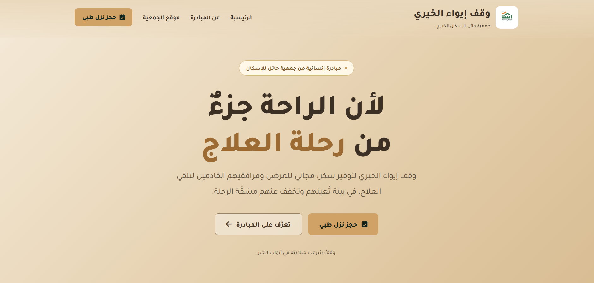
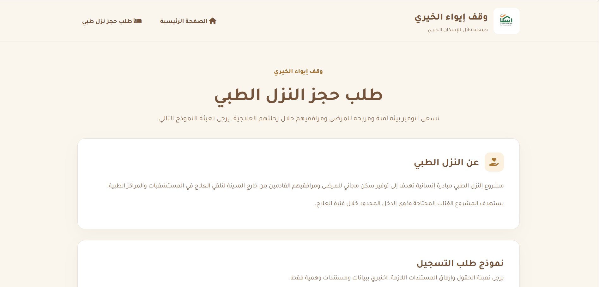

# Eiwaa Charity Web Platform
### Medical Accommodation Booking System

A full-stack web development project designed to simplify medical accommodation requests and support staff in managing applications for patients and their companions.

**Developer:** Shamma Thari Alreshidi  
**Original Development:** January 2026  
**Post-Graduation Enhancements:** 2026  
**Project Type:** Full-Stack Web Application  
**Status:** Functional Local Prototype

---

## Project Overview

Eiwaa Charity Web Platform is a medical accommodation booking system originally designed and developed in January 2026 during my cooperative training at Hail Housing Association in Saudi Arabia.

After graduating in June 2026, I independently revisited and enhanced the project by improving its booking workflow, database integration, staff dashboard, document handling, and access controls.

The platform provides an Arabic-language website where applicants can submit accommodation requests, enter personal and booking information, and upload supporting documents.

An additional private employee dashboard allows authorized staff to sign in, review submitted applications, and view uploaded images and PDF documents.

The project demonstrates my practical experience in full-stack web development, database management, authentication, debugging, and software testing.

---

## Technologies Used

### Front-End
- HTML5
- CSS3
- JavaScript
- Responsive Web Design
- Arabic Right-to-Left (RTL) Interface

### Back-End
- PHP 8
- MySQL
- PHP Sessions
- Form Validation
- File Upload Processing

### Development Environment
- Visual Studio Code
- XAMPP
- Apache
- phpMyAdmin
- GitHub
- Google Chrome Developer Tools

---

## Project Features

### 1. Arabic Website
- Arabic user interface with RTL support.
- Responsive design for different screen sizes.
- Informational homepage introducing the accommodation initiative.
- Navigation between the homepage and booking form.
- Consistent visual design and user-friendly layout.

### 2. Accommodation Request Form
- Online medical accommodation request form.
- Full name and marital status fields.
- National identification and mobile number fields.
- Admission and discharge date selection.
- Required-field validation.
- Client-side and server-side validation.
- Request submission and database storage.

### 3. Document Uploads
- National identification document upload.
- Social security document upload.
- Medical appointment document upload.
- Support for JPG, PNG, and PDF files.
- Validation of supported document formats.
- Document storage outside the public website directory.

### 4. MySQL Database Integration
- MySQL database for storing applications.
- Application details stored in structured records.
- Connection between PHP and MySQL.
- Retrieval of submitted applications for staff review.
- Testing with fictional application information.

### 5. Private Employee Dashboard
- Employee authentication using a password.
- Password hashing.
- Session-based access control.
- Dashboard available to authenticated staff.
- Display of submitted applications.
- Applicant details and booking dates.
- Image document previews.
- PDF document viewing.
- Employee logout functionality.

### 6. Access Protection
- Restricted access to uploaded documents.
- Validation of document requests.
- CSRF protection for supported authentication actions.
- Session management.
- Input and file validation.
- Separation of private uploads from publicly accessible website files.

### 7. Testing and Debugging
- Local application testing using XAMPP.
- Database connection troubleshooting.
- PHP error identification and debugging.
- Testing successful form submissions.
- Verification of saved database records.
- Testing employee authentication.
- Testing image and PDF document viewing.
- Verification that documents cannot be accessed after logout.

---

## My Role – Full-Stack Web Developer

I independently designed and developed the original Eiwaa Charity Web Platform during my cooperative training at Hail Housing Association.

Following graduation, I continued improving the project independently.

### During Cooperative Training – January 2026

My responsibilities included:

- Designing and developing the website structure.
- Creating responsive Arabic web pages.
- Developing the informational homepage.
- Building the accommodation registration form.
- Implementing front-end interactivity.
- Working with PHP and MySQL.
- Testing the website and improving usability.

### Independent Enhancements After Graduation – 2026

I expanded and improved the system by:

- Enhancing the booking form and its validation.
- Improving server-side request processing.
- Integrating and testing MySQL data storage.
- Developing a private employee dashboard.
- Implementing employee authentication.
- Adding session-based access control.
- Protecting access to uploaded documents.
- Enabling image and PDF document previews.
- Troubleshooting PHP and database errors.
- Testing the complete local application workflow.

These improvements helped transform the original website into a functional local prototype with applicant and employee interfaces.

---

## System Workflow

### Applicant Workflow

1. Open the accommodation website.
2. Navigate to the booking request form.
3. Enter the required personal information.
4. Select accommodation dates.
5. Upload supporting documents.
6. Submit the request.
7. The validated request is saved in the MySQL database.

### Employee Workflow

1. Open the private staff dashboard.
2. Sign in using employee credentials.
3. View the list of submitted applications.
4. Review applicant information.
5. Open uploaded image and PDF documents.
6. Log out to end the authenticated session.

---

## Screenshots

The screenshots are intended to demonstrate the system using fictional information only.

### Homepage

### Accommodation Booking Form

### Employee Dashboard

The screenshots will be added after confirming that they contain no confidential information or unauthorized branding.

---

## Project Architecture

The local prototype consists of:

- A public-facing homepage.
- A PHP-based accommodation registration form.
- A MySQL database for storing requests.
- A private employee dashboard.
- A protected server-side document storage directory.

PHP handles request processing, database operations, authentication, and protected document delivery.

The application was developed and tested locally using Apache, PHP, and MySQL through XAMPP.

---

## Security and Privacy

This project involves workflows that may include sensitive personal and medical information.

For privacy and security reasons:

- Real beneficiary information is not included in this portfolio.
- Uploaded personal and medical documents are excluded.
- Database credentials are not published.
- Private database records are not published.
- Employee passwords and authentication sessions are not shared.
- Screenshots must use fictional information only.
- Organization-specific materials are subject to publication permission.

The private employee dashboard and document access controls were tested in the local development environment.

**Important:** This is a functional local prototype, not a security-audited production deployment.

The operational source code and confidential files are not part of the public portfolio materials.

---

## Project Status

**January 2026:** Original website developed during cooperative training.

**June 2026:** Graduation from the University of Hail.

**After Graduation – 2026:** Independent improvements to the booking workflow, database integration, document handling, and private employee dashboard.

**Current Status:** Local prototype successfully tested for request submission, database storage, employee authentication, and image/PDF viewing.

The portfolio repository is being prepared with safe documentation, demonstration screenshots, and any approved materials.

---

## Organization

**Hail Housing Association**  
Hail, Saudi Arabia

The original project was developed during my cooperative training with the organization.

Any public sharing of organization-specific code, branding, or materials is subject to the organization's permission.

---

## Skills Demonstrated

- Full-Stack Web Development
- Front-End Development
- Back-End Development
- PHP Programming
- MySQL Database Integration
- Authentication and Session Management
- File Upload Handling
- Responsive Web Design
- Arabic RTL Interface Development
- Form Validation
- Debugging and Troubleshooting
- Software Testing
- Problem-Solving
- Independent Project Enhancement

---

## Developer

**Shamma Thari Alreshidi**

Bachelor's Degree in Computer Engineering  
University of Hail, Saudi Arabia  
Graduated: June 2026

**GitHub:**  
https://github.com/shamma-engineer

**LinkedIn:**  
https://www.linkedin.com/in/shamma-thari

---

## Disclaimer

This repository is intended for educational and professional portfolio presentation.

It does not contain real beneficiary data, confidential documents, or private operational credentials.

The project should not be considered production-ready without further security review, organizational authorization, and appropriate deployment safeguards.

